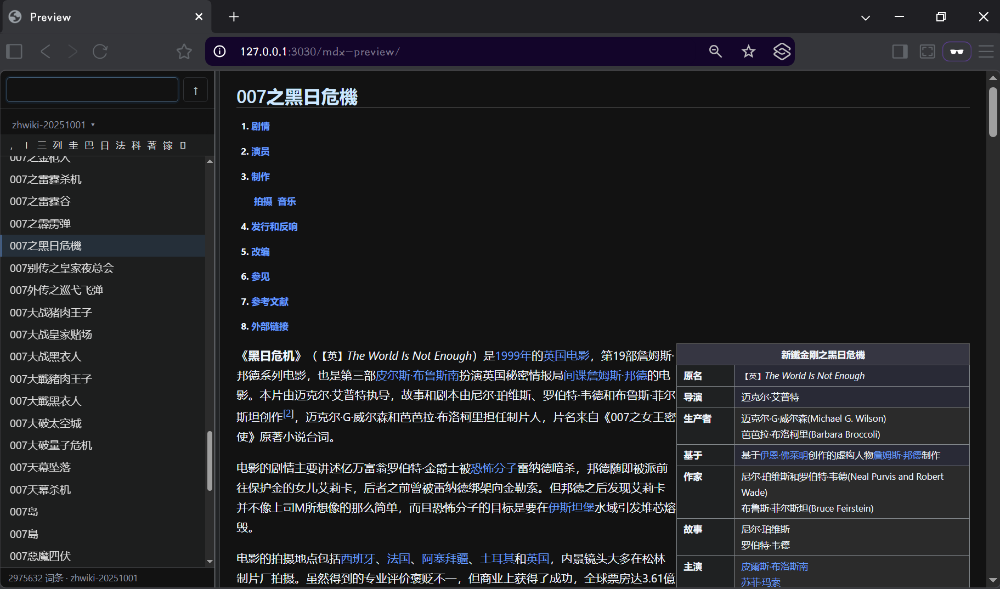

# prev

[](https://github.com/AnabasisXu/mdx-preview/actions/workflows/build.yml)
[](https://github.com/AnabasisXu/mdx-preview/releases)
[](#许可证)

单文件 MDict（`.mdx` / `.mdd`）浏览器，inspired by [Preview - 修改MDX CSS的神器，支持CSSJS实时预览](https://forum.freemdict.com/t/topic/1251)



## 与 Preview 的关系

本项目起源于对 Preview 0.1.8 的静态逆向与协议重建：沿用它的路由家族（`/api/parser`、`/api/item`、`/api/lookup`、`/api/static`、`/api/v1/ws/`、`/dist`）、WebSocket RPC 与词条模板占位符，之后重写解析器、改为单文件 CLI，并加入多词典与惰性索引。反编译无法恢复原版源码，函数体是重建的。

当前版本**尚未**对齐 Preview 的能力：拼写提示下拉、多端搜索结果同步（这里只同步“打开词条”）；随机词头由 F5 触发，刷新页面不会自动换词。同目录 CSS/JS 热更新与 `entry://` / `sound://` 链接改写已经补上（见「实现要点」）。

## 快速开始

```sh
prev dictionary.mdx
# prev: 68584 headwords from dictionary.mdx
# listening on http://127.0.0.1:3030/mdx-preview/
```

```sh
prev ~/Dictionaries            # 递归加载目录下所有 .mdx
# prev: 12 dictionaries, 2843100 entries
# listening on http://127.0.0.1:3030/mdx-preview/
```

```sh
prev a.mdx b.mdx --port 8080 --base ""
```

打开打印出的地址即可。放在 GoldenDict 词典目录里运行时，每部词典自动加载同名的 `dictionary.mdd`、`dictionary.1.mdd`、`dictionary.2.mdd`。

### 参数

```
prev <path>... [--port N] [--base PATH]

  <path>        .mdx 文件，或目录（递归查找 *.mdx，含子目录）
  --port N      监听端口，默认 3030（只绑定 127.0.0.1）
  --base PATH   公开挂载前缀，默认 /mdx-preview
  -h, --help    输出版本与用法后退出
  -V, --version 输出程序版本
```

- `--base ""` 表示挂在站点根路径（`http://127.0.0.1:3030/`）
- 前缀可以是 `mdx-preview`、`/mdx-preview/` 等写法，自动规范化
- 环境变量 `PREVIEW_BASE` 可覆盖 `--base`
- 目录递归不跟随符号链接目录；同一文件重复给出只加载一次；解析失败的词典跳过并打印原因

## 界面与快捷键

| 操作 | 行为 |
|---|---|
| 启动 | 焦点直接落在搜索框，词表列出全部词头 |
| 输入 | 90 ms 防抖，按子串过滤，命中片段高亮 |
| ↑ / ↓ | 在词表中上下移动选择 |
| Enter | 打开选中词条（未选中时打开第一行） |
| Esc | 清空关键字，回到完整词表 |
| PgUp / PgDn | 按可视高度翻页；到已加载的任一端会继续向前/后取页，按住可连续翻 |
| Home / End | 无关键字时直接跳到词典的最前/最后一条；有关键字时跳到已加载结果的首/尾 |
| F5 | 随机查一个词条，词头填入搜索框并加载 |
| Ctrl+L | 回到搜索框并全选 |
| Ctrl+P | 打开/关闭词典搜索框：输入过滤、↑/↓ 选择、Enter 切换、Esc 关闭 |
| 搜索框下方词典按钮 | 打开词典搜索框（同 Ctrl+P） |
| Alt+1 … Alt+9 | 直接切到第 1–9 部词典 |
| Alt+← / Alt+→ | 在访问过的词条间后退 / 前进（可跨词典） |
| Ctrl+R | 切换正序/倒序（同搜索框右侧按钮），选择会记住 |
| 搜索框右侧按钮 | `↑` 正序 / `↓` 倒序（词典文件原序的正向或反向），刷新后保持 |
| 搜索框下方跳转条 | 均匀覆盖全部词头：第一个按钮对应第 1 条、最后一个对应最后一条，中间等距；按钮数量随左栏宽度自适应，不横向滚动 |
| 左栏分隔条 | 拖动调整宽度（存 localStorage），双击复位 260 px |

状态栏显示当前词典的词条总数与名称；多部词典时附带 `(当前/总数)`。每部词典的搜索词、翻页位置和选中行在切换时各自保留，刷新后按词典名恢复上次使用的词典。

### 与 Surfingkeys 的配合

- 普通点击词条正文后，键盘焦点交回左栏：顶层文档的快捷键（本页的 F5、Alt+←/→、Ctrl+L，以及 Surfingkeys 的映射）继续可用。
- 拖选文本时焦点留在词条内，Ctrl+C 复制的仍是词条内容。
- 若焦点确实在词条 iframe 里（例如用 Surfingkeys 的 `w` 选择 frame），按键由该 frame 内的 Surfingkeys 实例处理：`f` 只提示这个 frame 里的链接（prev 的词条通常没有链接，所以看起来没反应），其余映射也只作用于该 frame。用 `w` 回到顶层即可恢复。
- Surfingkeys 在每个 iframe 中第一次按键会先完成一次初始化（这次按键被吞掉），因此 frame 内偶尔第一次按键无响应。

## 实现要点

- **解析**：单文件内实现 MDict v2/v1 读取，`Encrypted=2` 的 key block info 用 RIPEMD128 + 滚动 XOR 还原
- **启动**：只 `mmap` 文件和解析头部、记录块目录；key 段（词头表）在首次使用该词典时才解压，`.mdd` 索引在首次取资源时才建立。因此目录模式下加载几十部词典也只有毫秒级启动开销
- **内存**：词头索引与记录块目录常驻，正文按需解压；未被浏览过的词典只占一个 mmap
- **多词典**：词条 id 是词典内序号 + 1，所有接口带词典下标——`/api/d/{dict}/item/{k_id}`、`/api/d/{dict}/lookup/{word}`、`/api/d/{dict}/res/{path}`；WebSocket 请求体增加 `dict` 字段。`/api/parser` 返回 `{dicts:[{id,name,count,path}]}`
- **编码**：按头部 `Encoding` 用 `encoding_rs` 解码（UTF-8 / GBK / Big5 / Shift_JIS …），UTF-16 走单独分支
- **重定向**：`@@@LINK=目标词头` 在请求时解析（最多 16 跳，带环检测），只在本词典内跳转
- **资源**：`.mdd` 按需读取压缩块；词条页用 `<base href="{base}/api/d/{dict}/res/">` 把相对路径固定到所属词典。根绝对路径（`/img.png`）不带词典信息，兜底路由先看请求的 `Referer`（`/api/d/{n}/...`）再按加载顺序找第一个命中
- **热更新**：词典同目录下与资源同相对路径的 `.css` / `.js` 会**优先于** `.mdd` 内的副本（`Cache-Control: no-store`）；文件保存时 `notify` 监听目录，WebSocket 广播 `{"event":"reload","dict":N}`，浏览器重载当前词条并带时间戳绕过缓存。其他文件仍从 `.mdd` 读取
- **链接**：渲染词条时把 `href="entry://词头"` 改写为词条路由（查不到目标词头则保留原样），`src|href="sound://文件"` 改写为 `.mdd` 资源路由
- **挂载**：所有路由通过 `web::scope(--base)` 挂载，页面内生成的链接与路由前缀一致；裸 `/` 302 到前缀
- **同源**：WebSocket 握手校验 `Origin` 的 host 与 `Host` 一致，跨站页面无法连接本地服务读取词典；不带 `Origin` 的本地客户端（脚本、测试）照常可用

## 性能（Linux 实测：Debian 13，4 vCPU，8 GB）

| 词典 | 词条 | 启动 | 常驻内存 (RSS) | 取词条 p50 | 搜索 p50 |
|---|---|---|---|---|---|
| swift-mt | 872 | 0.06 s | 8.8 MB | 0.3 ms | 0.1 ms |
| Wiktionary EN 2021（CC BY-SA） | 977 956 | 0.45 s | 141.3 MB | 0.3 ms | 3.6 ms |

常驻内存的主体是词头索引；正文按需解压，不随词典体积线性占用。改造前会把全部正文解压进内存，数 GB 的词典无法加载。

> 上表是“打开即建索引”版本的测量值。现在索引推迟到该词典首次使用（打开词条列表或搜索）时构建，进程启动本身是毫秒级；单词典的首屏时间与上表启动列大致相当，多词典则只付被浏览那一部的代价。

## 内存实测（Linux，2000 次取词 + 120 次搜索）

| 词典 | 起始 RSS / 匿名 | 压测后 RSS / 匿名 | 空闲 3 s 后 |
|---|---|---|---|
| swift-mt | 8.8 / 3.6 MB | 9.0 / 3.7 MB | 不变 |
| Wiktionary EN 2021 | 141.3 / 128.5 MB | 155.0 / 128.6 MB | 不变 |

压测后 RSS 的增长来自按需解压的记录块（约 14 MB），匿名内存（索引 + 堆）基本不变。

## 构建

```sh
cargo build --release
# 产物：target/release/prev
```

Windows 交叉编译（Linux 上）：

```sh
cargo install cargo-zigbuild
cargo zigbuild --release --target x86_64-pc-windows-gnu
# 产物：target/x86_64-pc-windows-gnu/release/prev.exe
```

仓库自带 GitHub Actions：Linux 构建 `prev`；Windows 用 zig 交叉编译 GNU 版 `prev.exe`，与本地 `cargo zigbuild` 产物同一目标（`x86_64-pc-windows-gnu`），不是 MSVC 构建。

## 已知限制

- LZO 压缩的词典不支持（v1 老词典偶见），会给出明确错误
- `Encrypted=1/3`（需要用户识别码）的词典拒绝加载；对应的 `.mdd` 会被跳过
- 记录块没有缓存，同一页大量图片会重复解压所在块（实测 95 张图仍为秒开）
- 词条页的 `<base>` 会改变相对链接语义，`#锚点` 已单独拦截处理；相对路径资源默认走 `.mdd`，缺失时 404
- 热更新只覆盖与资源同相对路径的 `.css` / `.js`（放在 `.mdx` 同目录）；其他文件、`.mdx` / `.mdd` 本身改动不会热加载，需要重启
- `entry://` 改写依赖能在词头表里精确查到目标词头，查不到时链接保持原样，浏览器会显示导航错误
- 根绝对路径资源在多词典下可能有歧义：先按 `Referer` 找所属词典，找不到再按加载顺序取第一个命中；两部词典有同名资源时可能显示错图（相对路径不受影响）
- 首次在某部词典里搜索或打开词条会构建它的词头索引，百万级词条约 0.4 s，期间状态栏显示“正在读取索引…”
- `@@@LINK=` 只在本词典内跳转，不跨词典
- 排序方向是全局设置，不按词典分别记忆
- 超大词典的索引常驻内存：百万级词条约 130–150 MB，随词头数量线性增长
- 页面外壳、前端脚本与词条页都不缓存（`Cache-Control: no-store`）；升级 prev 后如果还开着旧标签页，刷新一次即可，否则旧页面会继续调用上一版的接口地址并得到 404

## 测试

```sh
python3 tests/smoke.py target/release/prev /path/to/sample.mdx
# ok: 2 dictionaries, HTTP and WS contract verified
```

脚本用同一份词典的两个副本加一个截断文件启动 prev，检查词典列表、每部词条的 `<base>`、lookup、未知词典 404、WebSocket 的 `dict` 路由与 `redirect` 广播、跨站 `Origin` 被拒（403）、同目录 CSS 覆盖（磁盘文件优先于 `.mdd`）、保存 CSS 后收到 `reload` 事件，以及损坏文件被跳过。

## 更新记录

- **0.2.1**：新增 `prev --version` / `-V`；Linux 增加静态 musl 产物（老发行版可直接运行）；采用 MIT OR Apache-2.0 双许可；tag push 由 CI 自动构建并发布 release。
- **0.2.0**：一次加载多部词典（`.mdx` 文件或目录，递归含子目录）；接口按词典命名空间化并加入词典切换器；词表索引按词典惰性构建，目录模式启动为毫秒级；跳转条改为等距覆盖并随左栏宽度自适应；点击词条后焦点回到外壳，Surfingkeys 继续可用；支持同目录 CSS/JS 覆盖与保存后热重载，`entry://` / `sound://` 链接触发词条与资源跳转；损坏的 `.mdx` / `.mdd` 报错并跳过而不是崩溃。
- **0.1.0**：首个版本，单文件 MDX/MDD 预览器。

## 目录

```
src/main.rs             解析器 + HTTP/WebSocket 服务
src/static/index.html   外壳：左栏词表 + 词典选择浮层 + 右侧词条 iframe
src/static/utils.js     前端逻辑：分页、排序、跳转条、词典切换、快捷键
src/static/site.css     外壳样式
src/static/item.html    词条模板（通用排版 + 资源 base）
tests/smoke.py          HTTP/WS 冒烟测试
docs/plans/             设计与实施计划
```

## 许可证

MIT OR Apache-2.0 双许可，任选其一：[LICENSE-MIT](LICENSE-MIT)、[LICENSE-APACHE](LICENSE-APACHE)。
